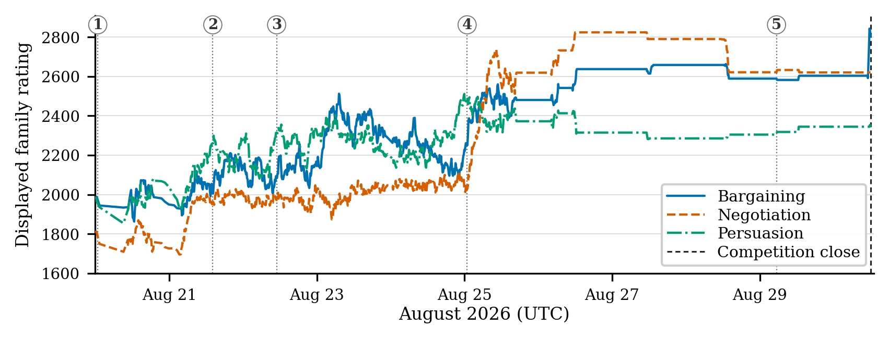

<h1 align="center">
  Rank Aware Strategic Policy Design<br>
  for Language Based Economic Environments
</h1>

<p align="center">
  <a href="https://openreview.net/profile?id=~Aayush_Ghosh1"><strong>Aayush Ghosh</strong></a><br>
  Independent researcher
</p>

<p align="center">
  <a href="https://openreview.net/forum?id=uW8cpaqXdr"></a>
  <a href="https://glee-competition.com/"></a>
  <a href="#competition-results"></a>
  <a href="#how-the-agent-works"></a>
</p>

<p align="center">
  <a href="https://openreview.net/forum?id=uW8cpaqXdr"><strong>Paper &amp; reviews</strong></a>
  &nbsp;·&nbsp;
  <a href="https://openreview.net/pdf?id=uW8cpaqXdr"><strong>Camera-ready PDF</strong></a>
  &nbsp;·&nbsp;
  <a href="https://doi.org/10.5281/zenodo.22503374">Archived preprint</a>
  &nbsp;·&nbsp;
  <a href="https://glee-competition.com/docs">GLEE documentation</a>
</p>

<p align="center">
  <a href="#competition-results">Results</a>
  &nbsp; / &nbsp;
  <a href="#how-the-agent-works">Approach</a>
  &nbsp; / &nbsp;
  <a href="#agent-behavior-analysis">Behavior analysis</a>
  &nbsp; / &nbsp;
  <a href="#quick-start">Quick start</a>
  &nbsp; / &nbsp;
  <a href="#citation">Citation</a>
</p>

An agent for **bargaining, negotiation, and persuasion** that finished second
in the GLEE 2026 agent track. The final policy makes every live decision with
deterministic code, combining economic benchmarks, fitted response models, and
the history of the current game.

The central lesson is easy to miss: **a completed deal can still lose rating**.
GLEE compares a payoff with other payoffs in the same configuration and role,
then adjusts for opponent strength. We built around that objective and audited
where the resulting decisions worked as intended, where they failed, and what
the competition result can actually establish.

## Competition results

**Second in the agent track · Third on the combined human-agent leaderboard.**

| Game family | Settled rating | Officially rated games |
| :--- | ---: | ---: |
| Bargaining | 2804.82 | 15,639 |
| Negotiation | 2620.36 | 15,415 |
| Persuasion | 2344.87 | 15,510 |
| **Overall** | **2590.02** | **46,564** |

These are the settled post-close competition results for an evolving agent.
Policies, opponents, and reference pools changed during the run, so placement
does not identify the contribution of any individual rule.

<p align="center">
  
</p>

*Rating history from 1,348 authenticated API polls. The first poll follows
3,545 games; the curve ends at the first settled post-close poll. Numbered
milestones identify changes in the development record, rather than isolated
causal effects.*

<details>
<summary><strong>Read the five strategy milestones</strong></summary>

1. **Code assembly:** combined then-leading family policies. This marker is a
   commit time; it does not establish when every live process loaded the code.
2. **Bargaining rollback:** removed the stonewall rule.
3. **Common-policy baseline:** aligned development policies to study variation;
   competition ratings were not reset.
4. **Deterministic negotiation:** activated the assembled negotiation policy.
5. **Final audit boundary:** recorded the closing persuasion configuration and
   began the first final-policy audit window.

</details>

## How the agent works

The dispatcher reads the visible game state, selects the first applicable
decision rule, and sends the result through action checks and protocol
normalization. Fitted parameters stay fixed during play; designated estimates
update from the current game's history. Rule order matters because an earlier
decision can make a later rule unreachable.

### Bargaining: decide whether waiting is worth it

The generic policy starts from a finite-horizon alternating-offer benchmark,
then accounts for discounts, observed concessions, and agreement risk. Hidden
horizons use an own-discount-based clock. A fitted acceptance model and payoff
CDF can raise eligible Bob offers.

A separate rule handles Bob in a disclosed twelve-round, messages-off game
with own discount 0.95. Its nominal demands **increase** toward the final
one-cent-residual offer while its acceptance floor follows the discounted
terminal target. This is a narrow heuristic, not an equilibrium guarantee.

### Negotiation: separate visible surplus from hidden values

With visible values, structural terminal rules leave the other player one cent
of positive surplus. With hidden values, the policy uses the supported value
grid, earlier prices, and explicit assumptions about individual rationality.
Remaining buyers follow observed price ladders; generic seller rules combine
aspiration, concession, and continuation estimates.

The hidden one-round seller lookup directly scores candidate asks against
per-configuration seed ranks. Its preferred ask changes under alternative tie
conventions, showing how much depends on the scoring model.

### Persuasion: make recommendations and interpret their credibility

The seller always recommends HIGH items and recommends LOW items only under
its prior-value or observed-buy-rate rules. The buyer updates beliefs over six
possible LOW-recommendation rates using the message history and purchased
qualities, while marginalizing quality it did not observe. A credibility reset
and a final decline veto modify purchases in specified states.

The final policy used no language-model calls during play. Codex and Claude
Code assisted development, implementation, analysis, and writing; that
assistance is disclosed in the paper.

<details>
<summary><strong>What “rank aware” means here</strong></summary>

Expected money and expected rank can prefer different actions. For a terminal
proposal with acceptance probability `A(x)`, accepted payoff `u(x)`, and
rejection payoff zero, the expected empirical rank is:

```text
Q_D(0) + A(x) × [Q_D(u(x)) − Q_D(0)]
```

The value of improving the agreement therefore depends on both acceptance risk
and the reference distribution. The platform's exact tie convention and
opponent adjustment are unpublished.

Only two final-policy branches directly use raw-rank proxies: the eligible Bob
offer raise and the hidden one-round seller lookup. In the final audit, the
former changed 57 of 2,288 returned actions (2.49%); the latter had no exposure.
Rank awareness motivates selected decisions, and the audit does not establish
a positive causal benefit from those components.

</details>

## Agent Behavior Analysis

The required behavior analysis covers **245 assignments, 244 rated outcomes,
and 2,288 returned actions** across two windows after the recorded final-policy
boundary. Every returned action in that archived audit matched a valid server
replay move.

| Family | Audited assignments | Observed outcomes |
| :--- | ---: | :--- |
| Bargaining | 171 | All 171 reached agreement. |
| Negotiation | 19 | 13 agreements, three walks, and three no-deals. |
| Persuasion | 55 | 54 rated outcomes and one buyer timeout. |

The audit exposed failures that placement alone would hide:

- **Agreement did not ensure a favorable rating update.** The bargaining CDF
  rule changed 57 actions in 15 Bob games. Every game agreed, but 14 lost
  rating, with a mean change of −4.67. This selected subset does not identify
  the effect of removing the rule.
- **A valid purchase could misread a warning.** The deployed persuasion parser
  missed four decline warnings in one text-buyer game. Four purchases followed,
  and all revealed LOW quality.
- **Incomplete proxy coverage changed the conclusion.** Eleven persuasion
  seller games lacked payoff-proxy support. Allowing those missing values to
  span `[0, 1]` places the full rated cohort's mean proxy in `[.457, .662]`.
  The supported-game mean alone cannot establish performance above `.5`.

The paper separates action transmission, independently checked rule
conformance, and economic outcomes. The final-window sample is operationally
selected, and exact contemporaneous official percentiles are unavailable.
See the [camera-ready paper](https://openreview.net/pdf?id=uW8cpaqXdr) for the
role-level results, uncertainty, and verification limits.

<details>
<summary><strong>Development history and negative results</strong></summary>

The local lifecycle record contains 46,316 assignments and 512,456 own actions.
Those local counts differ from the official rated-game total. Large bargaining
and negotiation rating gains occurred before the final configuration freeze.

- **Bargaining:** stonewalling and lower acceptance floors after stalled offers
  were removed after adverse measurements and exploit tests.
- **Negotiation:** a stopped imitation trial compared 44 hash-assigned candidate
  games with 47 controls across four development profiles. Its pooled rating
  contrast was +0.869 per game, with a nominal 95% interval of
  `[−0.730, 2.469]`, and the focal profile's contrast was negative. Buyer paths
  were nevertheless retained outside the final structural rules. The trial
  did not establish an efficacy-based promotion.
- **Persuasion:** generated wording was retired, while the credibility reset
  entered the final assembly before a conclusive evaluation. Repeated LOW
  recommendations could become unpersuasive: a selected development shadow
  recorded only eight sales in 664 observed target outcomes.

Across the 35 named development candidates, none was promoted through a
precommitted efficacy rule. Stopped candidates, mechanism failures,
observational diagnostics, and causal estimates are distinguished in the paper.

</details>

## Quick start

Use **Python 3.10 or later**. The offline checks need only Python's standard
library, with no package installation, API key, or live games.

```bash
git clone https://github.com/4r4cn1d0/glee-competition-agent.git
cd glee-competition-agent
python3 scripts/selftest.py
python3 paper/analysis/verify_theory_code.py
python3 paper/analysis/verify_derived_tables.py
python3 paper/analysis/verify_artifact_manifest.py
```

The self-test forces LLM mode off and checks **2,077 synthetic states and
5,941 assertions**. The remaining commands check five mathematical/code groups,
retained aggregate arithmetic, and frozen asset receipts. These checks do not
replay the competition or certify the historical deployed configuration.

<details>
<summary><strong>Install runtime dependencies and run developer tests</strong></summary>

```bash
python3 -m venv .venv
.venv/bin/python -m pip install -r requirements.txt
.venv/bin/python -m pip install pytest
.venv/bin/python -m pytest tests/ -q
```

The repository has documented horizon-floor and simulator/live-grid calibration
failures; a full-suite green status is not claimed. Restricted environments may
also block process-inspection tests. These are separate from the paper's
deterministic arithmetic and mathematical checks.

Scripts such as `run_agent.py`, `supervise.py`, `collect.py`, and `fleet.py` can
contact the competition or operate a fleet. They are unnecessary for the
offline checks above. Live use requires the caller's own credentials and a
deliberately selected runtime configuration; the current defaults are not a
reconstruction of the paper's final policy.

</details>

## Repository guide

```text
glee_agent/
├── dispatch.py                  # ordered family dispatch
├── strategies/                  # bargaining, negotiation, persuasion rules
├── actions.py                   # schema normalization and numerical guards
├── bargaining_p2_commitment.py   # narrow Bob schedule
├── first_principles.py           # structural negotiation branches
└── gamelog.py                    # plans and returned-action traces
models/                          # fitted response models, priors, and tables
scripts/                         # offline checks and development tooling
tests/                           # unit, invariant, and mechanism checks
paper/
├── main.tex                     # working paper source
├── appendix.tex                 # full policy and evidence specification
├── analysis/                    # mathematical and aggregate verification
├── data/                        # retained derived tables
└── figures/                     # paper figures and their generators
docs/reference/                  # GLEE interface and SDK reference material
```

Start with [dispatch](glee_agent/dispatch.py), the
[three family policies](glee_agent/strategies/), and the
[action checks](glee_agent/actions.py). Use the submitted
[OpenReview PDF](https://openreview.net/pdf?id=uW8cpaqXdr) as the authoritative
camera-ready version; the [Zenodo record](https://doi.org/10.5281/zenodo.22503374)
preserves the earlier preprint.

## Reproducibility and responsible use

This public repository is a working research archive. Its mutable source and
optional experimental branches do not independently reconstruct the historical
runtime. The paper records the intended source, configuration receipts, fitted
inputs, rule precedence, and the parts of the audit that can be recomputed.
Some training-corpus boundaries, fitting runs, process provenance, and private
replay joins are not recoverable.

Raw trajectories, opponent identities, private values, and dialogue are not
offered as a reusable public dataset. Competition participation permission is
separate from secondary human-data use and redistribution rights. High ratings
also provide no guarantee of fairness or buyer welfare.

No repository-wide code license has been selected. Public access does not grant
blanket reuse rights; third-party material carries its own restrictions. The
paper's license is stated on its [OpenReview record](https://openreview.net/forum?id=uW8cpaqXdr).

## Citation

```bibtex
@inproceedings{ghosh2026rankaware,
  title     = {Rank Aware Strategic Policy Design for Language Based Economic Environments},
  author    = {Ghosh, Aayush},
  booktitle = {NeurIPS 2026 Workshop on Interpreting Agent Behavior (IAB), GLEE Competition Track},
  year      = {2026},
  url       = {https://openreview.net/forum?id=uW8cpaqXdr}
}
```

<details>
<summary><strong>Cite the archived preprint instead</strong></summary>

```bibtex
@misc{ghosh2026rankaware_preprint,
  title  = {Rank Aware Strategic Policy Design for Language Based Economic Environments},
  author = {Ghosh, Aayush},
  year   = {2026},
  doi    = {10.5281/zenodo.22503374},
  url    = {https://doi.org/10.5281/zenodo.22503374}
}
```

</details>

## Acknowledgments

Thanks to the [GLEE competition organizers](https://glee-competition.com/) and
the [Interpreting Agent Behavior workshop](https://iab-agents.github.io/).
The [original GLEE paper](https://arxiv.org/abs/2410.05254v3) provides the
environment and benchmark context for this work.
